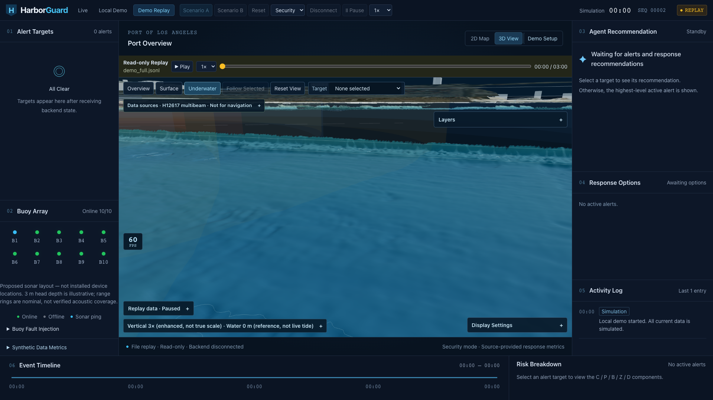
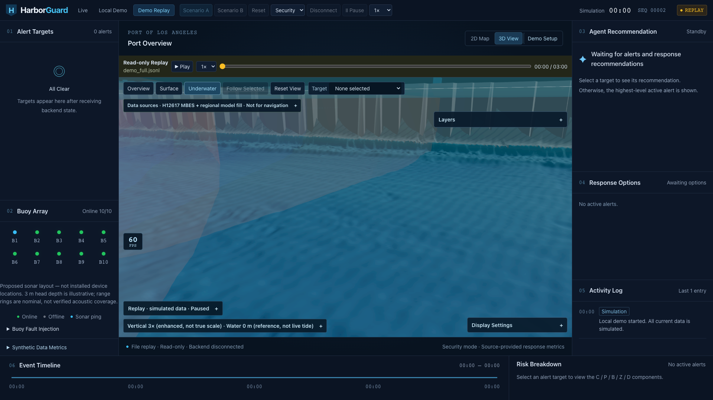
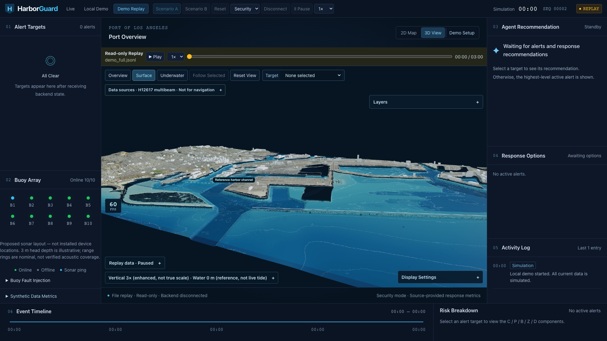
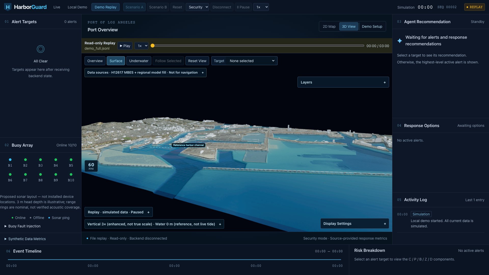
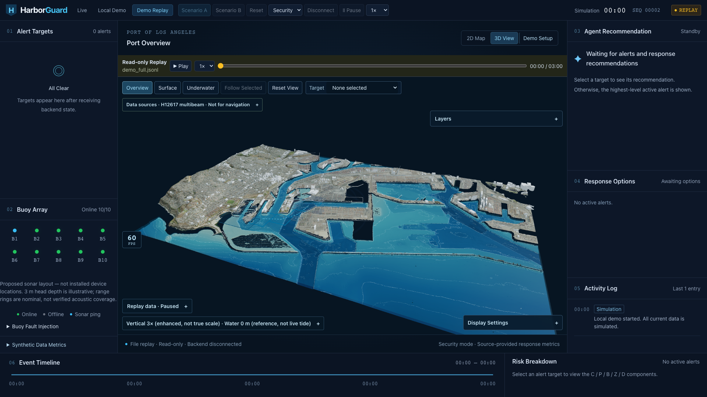
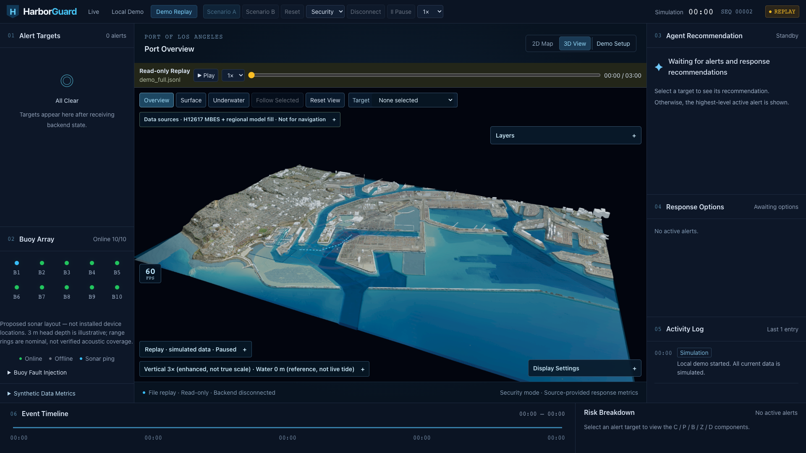

# 3D shoreline and underwater rendering — 2026-10-17 (PDT)

Branch: `fix/3d-shoreline-realism`, based on `main` `99d7091`.
Stack: React 19, strict TypeScript, React Three Fiber 9 / drei / Three.js.
No new JavaScript runtime dependency; postprocessing uses Three.js add-ons.

Complete [changed-file list](changed-files.txt) and [data/provenance hashes](data-manifest.json) accompany this report.

## Scope and precedence

The clarified PRD supplied in chat takes precedence over the original request:
H12617 values, coordinates and NoData cannot be smoothed, replaced or filled.
Missing coverage is supplemented by an **independent regional model layer**.
The acceptance performance target is **30 fps**, superseding the initial 45 fps
request. No Scenario A/B, Security, risk calculation, backend, contract, vessel
motion or replay-data logic was changed.

The source and validation documents were read before implementation. Earlier
Windows FPS observations in `frontend/3D-VALIDATION.md` and
`frontend/MULTIBEAM-VALIDATION.md` remain historical evidence for their named
commits, not performance evidence for this revision.

## What changed

- Regional model fill is on by default, with a separate Layers checkbox, muted
  colours, derivative-filtered diagonal hatching and no contours. It only draws
  cells that the respective 8 m or 1 m survey mesh does not support. Boundary
  vertices match valid source soundings. A distance field transitions unsupported
  fill toward the regional floor over 32 m (four harbor cells). All interpolation
  is on the independent fill, never in the measured source files.
- Regional fill follows the same aligned coarse/detail partition as the survey;
  it does not overlap the finer measured faces. The independent fill morphs to the coarse model over 32 m inside its patch boundary; all measured vertices remain pinned. Coarse survey boundary triangles
  split at supported fine-source edge vertices rather than adding vertical
  skirts or moving the existing soundings. Source NoData stays missing.
- Water uses the regional+survey **water domain**, rather than survey coverage.
  Zero-depth land and water-mask NoData are excluded. The merged planar mask
  needs 5,866 triangles, versus 8,876 for the old survey-only water mask, while
  covering more modelled water. This is a geometry count, not an FPS claim.
- USGS land was re-exported at 2304×1500: approximately **4.822×4.816 m** display
  sampling. Export disables automatic aspect-ratio adjustment, validates the
  returned geographic extent and spacing, and registers the TIFF pixel centres.
  The existing 3072×1668 NAIP image retains its own geographic bbox; texture UVs
  use that bbox, mipmaps and the device's maximum anisotropy. This is finer
  display sampling, not a new claim about native DEM or orthophoto accuracy.
- Land gets mask-aware 3×3 Gaussian display smoothing. Land and measured seabed
  normals use mask-aware central/one-sided differences before vertical scaling.
  H12617 elevations receive **no smoothing**. Gray quay-closure geometry connects
  land edges toward supported model-floor vertices within 50 m. An occluded below-floor closure reserve prevents small triangular leaks; this is land-side illustrative closure, not a skirt added to MBES. These connections
  are explicitly illustrative; no surveyed quay depth is claimed.
- Antialiased renderer plus a multisampled offscreen scene and FXAA; DPR remains
  capped at 2. Logarithmic depth and polygon offsets reduce shallow-water and
  contour depth conflicts. Geometry and material resources are disposed
  independently; terrain is memoized, independent of the 200 ms track snapshots.
- Optional procedural seabed detail normals, wet-sand band, distance/depth
  exponential scattering and a two-sided Fresnel/ripple surface. The interface
  approximates the water/air critical angle from below. These are illustrative
  lighting effects, not measured sediment, observed waves or a physical optics
  solution. Caustics are off by default. Every new effect has a Display Settings
  switch. Contours default off, with reduced opacity when enabled.

## Data and vertical reference

| Layer | Source and native support | Vertical reference / processing |
| --- | --- | --- |
| Measured harbor / inspection | NOAA/NOS H12617 (2013), 1–2 m BAG support, ~8 m harbor and ~1 m inspection display grids | MLLW; the two bundled JSONs are byte-for-byte unchanged |
| Independent nearshore fill | NOAA/NCEI Southern California Coastal Relief Model v2, **1 arc-second (~26×31 m)** | MSL retained; masked regional Gaussian smoothing, resampling, 32 m visual edge transition |
| Land | USGS 3DEP ImageServer, resampled to ~4.8 m | NAVD88 retained; optional display-only masked Gaussian |
| Shore imagery | Existing USGS/USDA NAIP mosaic, 3072×1668 | Orthophoto, not live imagery; independent image extent retained |
| Gray quay connections / effects | Constructed display geometry and shading | Illustrative, not measured bathymetry or surveyed quay engineering |

**No vertical-datum conversion is applied; offset = 0 m.** MSL, NAVD88 and MLLW
remain distinct. The 32 m visual interpolation is not a transformation between
these datums. No verified source/epoch-specific spatial transformation grid was
accepted for these products. A single VDatum station/API value would not
establish a valid transformation across the crop or the CRM compilation epochs.
The data panel and source metadata explicitly disclose this unresolved tie.

CUDEM has priority when a suitable local tile is supplied. The checked NOAA
8483 public URL list (942 entries) did not identify a Los Angeles Harbor tile;
**no installed Southern California CUDEM is claimed**. This revision therefore
uses CRM. The offline preprocessor accepts a local CUDEM GeoTIFF and optional
lower-priority CRM fallback. Both native references are recorded if they differ;
it does not silently invent a conversion. MBES remains the highest priority.

Sources: [H12617 catalog](https://www.ngdc.noaa.gov/nos/H12001-H14000/H12617.html),
[NOAA regional CRM](https://www.ncei.noaa.gov/products/coastal-relief-model),
[exact THREDDS subset](https://www.ngdc.noaa.gov/thredds/dodsC/crm/crm_socal_1as_vers2.nc.ascii?Band1%5B9720:1:9954%5D%5B16884:1:17316%5D),
[CUDEM 8483 download index](https://coast.noaa.gov/htdata/raster2/elevation/NCEI_ninth_Topobathy_2014_8483/),
[CUDEM URL list](https://noaa-nos-coastal-lidar-pds.s3.amazonaws.com/dem/NCEI_ninth_Topobathy_2014_8483/urllist8483.txt),
[USGS 3DEP service](https://elevation.nationalmap.gov/arcgis/rest/services/3DEPElevation/ImageServer),
[VDatum methodology/API](https://vdatum.noaa.gov/docs/services.html),
[export extent/aspect semantics](https://developers.arcgis.com/rest/services-reference/enterprise/export-image.htm).

## Reproduce without network access

The app loads bundled data and imagery. No terrain network service is called
at runtime. Install GIS packages once (or from an offline wheel cache):

```sh
cd frontend
python -m pip install -r scripts/requirements-shore-fill.txt
# Uses the bundled original CRM crop; no fetch and no change to either MBES JSON.
python scripts/prepare-shore-fill.py
python scripts/test-shore-fill.py
npm run check:a4
```

Optional data replacement / online refresh:

```sh
# Local upward-positive metre elevations; --datum must match source metadata.
python scripts/prepare-shore-fill.py --regional /offline/cudem.tif --datum NAVD88 --source-title "NOAA CUDEM 1/9 arc-second (verified local tile)" --source-url https://www.ncei.noaa.gov/products/coastal-elevation-models --fallback scripts/fixtures/crm-socal-crop.json
# A bounded NOAA crop, cached in ignored work/coastal; no whole-dataset download.
python scripts/prepare-shore-fill.py --fetch-crm
npm run refresh:shore-dem
# Orthophoto refresh is separate; a service timeout cannot replace either file.
npm run refresh:shore-imagery
```

Exported heights retain Float32 geometry precision, with 0.1 mm regional / 1 mm
land decimal serialization to avoid verbose binary tails. These decimal places
are not accuracy estimates. No 8-bit normalized heightmap is used. Raw regional
input, output provenance and unchanged survey hashes are recorded in metadata
and `data-manifest.json`.

## Validation

Passed: production build; lint (zero warnings); `check:a1`–`check:a6`,
`check:sonar`, `check:vessels`, `check:recovery`, `check:english`; four offline
preprocessing tests (including scaled Int16 and explicit NoData handling). Extended A4 covers source hashes and existing NoData
assertions, independent fill/no measured-face overlap, fine fill boundary pins,
actual returned land spacing, image registration, exact shared regional LOD boundary heights, continuous edge alpha,
mask-aware normals/smoothing, source-preserving LOD splits and supported quay
floor anchors. The original H12617 source-preservation assertions still pass.

The water regression changed domain deliberately: it tests against the new
regional+survey positive-depth **water mask**. A water surface may cross a
survey gap when the regional model supports water there, but it cannot bridge
land/NoData in the water mask. The legacy survey-only mesh/mask regression is
also retained. This change does not relax the measured seabed NoData rules.

## Same-camera evidence and performance

Final browser evidence is recorded in `browser-evidence.json`. Images use a
paused `demo_full.jsonl` at t=0, identical presets, 3× enhancement, defaults and
1920×1080 viewport. Performance is separately sampled with **Scenario A running**;
it is not inferred from paused screenshots. The unrelated metrics endpoint is
stubbed identically with null metrics in both builds to isolate 3D testing.

| Preset | Before (`99d7091`) | After |
| --- | --- | --- |
| Underwater |  |  |
| Surface |  |  |
| Overview |  |  |

Test host: Apple M2 integrated 8-core GPU, Chromium headless with ANGLE/Metal
(renderer independently queried). Both are production builds on the same host,
with identical viewport, DPR, default water/layers and running mock Scenario A.
Each preset restarts Scenario A, waits for camera settling, then records twelve
one-second UI FPS samples. Follow Selected uses simulated vessel T3.

| Running preset | Before mean / minimum | After mean / minimum |
| --- | ---: | ---: |
| Underwater | 60 / 60 | 60 / 60 |
| Surface | 60 / 60 | 60 / 60 |
| Overview | 60 / 60 | 60 / 60 |
| Follow Selected | 60 / 60 | 60 / 60 |

The observed 60 fps ceiling means **no measured performance improvement is
claimed**. The result meets the clarified 30 fps target on this host; it does not
prove the original 45 fps target on every midrange laptop. Frame-time percentiles
and thermal stability were not measured. Final browser errors: 0; disclosures and
all listed interactions: PASS.

The dashboard canvas is 1220×701 CSS pixels, with a 1830×1051 buffer at DPR 1.5,
inside the 1920×1080 page. This is not a full-page 1920×1080 canvas benchmark.
Evidence is a short reproducible on-device test, not a sustained thermal,
all-hardware, navigation, projector or field acceptance claim. Source-supported
quay slopes remain steep at 3×; they are not flattened to simulate extra survey
coverage. Native source resolution and the unresolved vertical tie remain
limitations even when visual seams are reduced.

The browser harness also exercises Surface, Underwater, Follow Selected, orbit,
zoom, 1×/3× restore, fill off/on and all effect switches, and checks disclosure
labels and browser errors. Its reproducible command is:

```sh
# Supply Playwright externally; it is not an application dependency.
node scripts/verify-shoreline-browser.mjs http://127.0.0.1:4177 http://127.0.0.1:4176 artifacts/underwater-fix
```

`Not for navigation`, measured/model/illustrative distinctions,
`Vertical N× (enhanced, not true scale)`, `Water 0 m (reference, not live tide)`
and simulated-data labels are preserved. Known bundled demo replays explicitly
say `simulated data`; arbitrary imported replays retain their source status.
