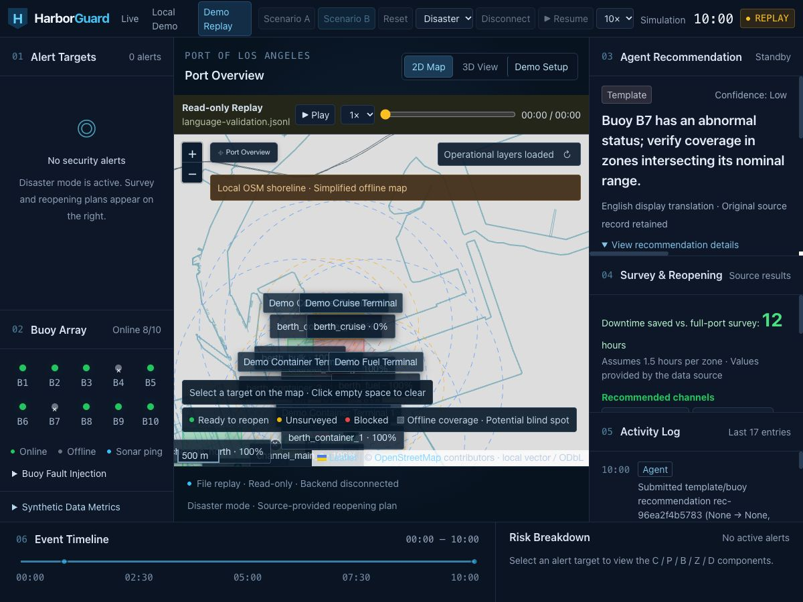

# Legacy source text in the English frontend — 2026-10-17 PDT

The running backend retained Chinese Agent recommendations, logs and nested
metric notes. Existing English UI labels did not translate those dynamic fields.

The frontend now renders known legacy messages in English. Deterministic log
and buoy-template patterns preserve IDs, model/provider names, timings and zone
lists. Exact-match translations cover the observed older model prose and metric
notes. Agent cards identify translated source text; future prose with no known
English rendering gets an explicit translation-unavailable message, never an
invented recommendation. New English model responses pass through unchanged.

Metric translation walks nested string leaves for display only. Numeric results,
failure history, denominators, provenance hashes, source records, recommendation
IDs, options and approval logic are unchanged. Error/notification display also
uses the English presentation function. No backend, Agent model configuration,
model weights, risk rules or shared service was changed or restarted.

Passed: production build / strict TypeScript, lint, `check:english`, `check:a5`.
The language regression fixture includes captured legacy Agent/log messages and
the backend metric response. Tests require actual translations for known text,
preserve every numeric metric leaf, check source non-mutation, and explicitly
check the unsupported-prose fallback. Existing synthetic/recorded replay checks
continue to pass.

Browser checks:

- Read-only replay of the captured current backend snapshot, latest buoy
  recommendation and 17 log entries. Expanded recommendation details: **0 Han
  characters**, no translation-unavailable fallback for these records. The
  screenshot below is this recorded-data replay, not a live-session claim.
- The running backend's actual metrics endpoint, with the synthetic-metrics
  panel and nested LoRA source configuration expanded: **0 Han characters**,
  no translation-unavailable fallback. The archived failed schema-mode result
  remains visible in English (20% structure validity / 30.3% option agreement /
  0% correct null / 14.4 seconds). These are displayed historical values, not a
  new model evaluation.
- The shared native Chrome window could not be captured reliably during this
  check; the screenshot uses the in-app browser at 1200×900. No scenario was
  reset and no recommendation/approval action was submitted.

